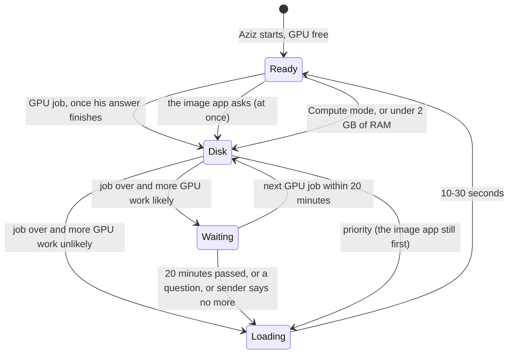
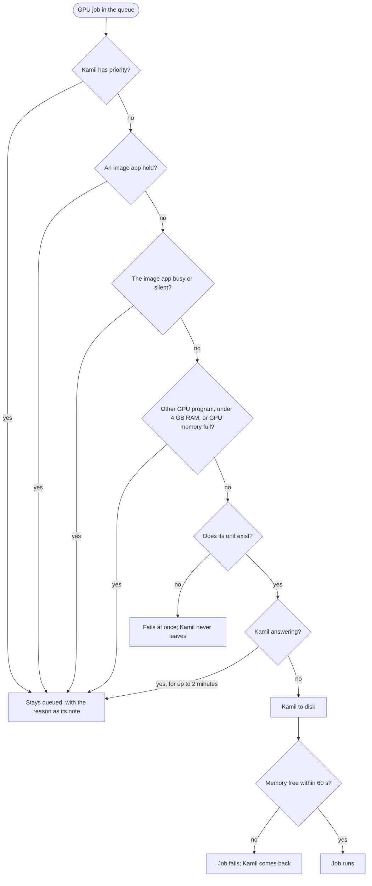

# Aziz

Aziz manages one GPU machine. He decides who gets the GPU, runs heavy jobs in order, keeps Kamil (the local model)
ready as much as he can, and writes down every decision. An image app, whatever you run on the GPU for that, always comes
first. He was written for [Kamil](https://github.com/KaramelliSundae/kamil-ai-helper), a study assistant.

**The order:** the image app → a student who asked for priority → GPU jobs → the idle model. CPU jobs never touch the model.

## Two modes

| Mode | Kamil | Jobs and the image app |
|---|---|---|
| **AI-Asistan** (`assistant`, the default) | Stays ready, moves aside when work needs the GPU, comes back by itself | Run in the order above |
| **Compute** (`compute`) | Stays off until you switch back | Run in the same order |

`POST /mode` with `{"mode": "assistant"}` or `{"mode": "compute"}`, the app's Settings, or `ai-ders mode`. The mode survives a
restart. The old names, `auto` and `image`, still work.

## Who talks to him

```mermaid
flowchart LR
    image_app[Image app] -- "POST /preempt: I need the GPU" --> aziz
    api[Kamil API] -- "POST /acquire: a question came" --> aziz
    phone[AI Ders app] -- "status, priority" --> api
    skill[Offload skill on the Mac] -- "POST /jobs + how likely more GPU work is" --> aziz
    aziz{{Aziz\nport 8421, localhost only}}
    aziz -- "start / stop" --> model[Kamil's model\nai-ders-llm]
    aziz -- "start / stop" --> cpu[offload-job@id]
    aziz -- "start / stop" --> gpu[offload-gpu-job@id]
    aziz -- "writes" --> log[(Logbook\n1 MB at most)]
```

## Where Kamil is



## How a GPU job is decided



## API

| Route | What it does |
| --- | --- |
| `POST /jobs` | `{id, label, gpu, nextGpu: "likely"\|"unlikely", restart, maxMinutes}`. Aziz starts `offload-gpu-job@ID` or `offload-job@ID` when its turn comes |
| `GET /jobs/ID`, `POST /jobs/ID/cancel` | One job's status; cancel it |
| `POST /forecast` | `{nextGpu}`: update the guess. It can end the wait, never extend it |
| `POST /priority` | `{on}`: Kamil first for 30 minutes. Refused in Compute mode |
| `GET /state`, `GET /log?limit=100` | Everything now; the logbook |
| `POST /preempt`, `/acquire`, `/mode` | Used by the image app, the Kamil API, and `ai-ders mode` |

Job names are `[a-z0-9-]`, at most 63 characters. A job interrupted by the image app or priority starts again from the
beginning, at most 3 times; send `restart: false` if rerunning it is not safe. GPU jobs stop after 4 hours and CPU jobs
after 12 unless `maxMinutes` says otherwise, up to a day. A GPU unit needs `TimeoutStopSec` under 10 s, so the image app never waits.

## Sending work from the Mac

The Mac side is a global skill and MCP tools in `~/.claude/skills/offload`, off until a project says `/offload on`.
**To connect it, run `deploy/offload/connect.sh` once, yourself.** It adds a dedicated key and SSH rule, with an automatic
undo until a fresh login works. Until then nothing can log in as `offload`.

- `client/`: the skill, `offload.py` and the MCP server. `client/install.sh` installs them.
- `deploy/offload/offload_gate.py`: all the key can run. Names and paths are checked there, and jobs go through Aziz.
- `deploy/offload/job.service.in`: the job sandbox, for CPU and GPU. No secrets, no local network, no local sockets, internet yes.

A job's project stays at `/var/lib/offload/jobs/<project>` with its caches; old job logs go after 14 days.

## Limits worth knowing

- **What survives a restart:** jobs, the GPU mode and the logbook. The 20-minute wait and priority do not, on purpose:
  a crash or reboot must bring Kamil back, never strand him.
- **No login:** he listens on localhost without a password, so job sandboxes must block localhost. Unit names are checked.
- **Not tried yet:** a real image job during a real GPU job. `/preempt` itself was tested on the real machine, freeing
  6 GB in 0.6 s, and the image app allows 20 s.

## Everyday

```sh
systemctl status aziz
journalctl -u aziz -n 30            # his log, also in /var/lib/aziz/journal.jsonl
curl -s localhost:8421/state        # on the server
deploy/deploy.sh                    # update, from this repo; waits until the image app is idle
```

## Tests

```sh
uv run --group dev pytest                                   # light, fine anywhere
AZIZ_SIM_SEEDS=4000 deploy/capped.sh pytest tests/test_simulation.py   # on the server, half a core and 1 GB at most
```

`tests/test_simulation.py` lives random days in the machine's life with faults, crashes, reboots and the image app interruptions,
and checks what must always hold: one GPU job at most, never beside the model or the image app, and in the end every job
finished and the model back. See [docs/scenarios.md](docs/scenarios.md) for each case.

## Setting him up on your machine

`deploy/deploy.sh user@server` installs him. What only your machine knows goes in files outside the repository:

| File | What goes in it |
| --- | --- |
| `/etc/aziz/env` | `AZIZ_IMAGE_APP_UNIT`, the systemd unit of your image app; `AZIZ_IMAGE_APP_HEALTH`, its health address; `AZIZ_IMAGE_APP_NAME`, what to call it on the phone |
| `/etc/aziz/offload.env` | `OFFLOAD_EXTRA_HIDDEN`, more paths to hide from jobs; `OFFLOAD_TOOL_BINDS`, tools to lend them |

The image app reports `gpuGate: true` and its queue on its health address, and calls `POST /preempt` before it takes the GPU.
