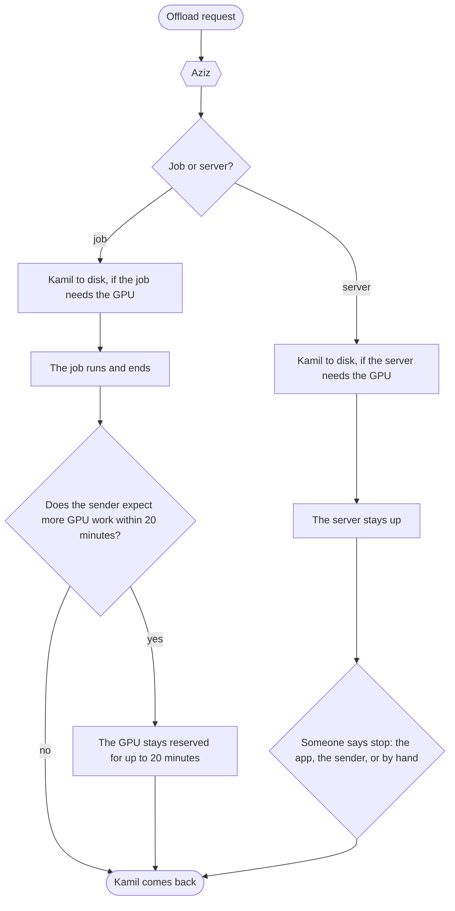
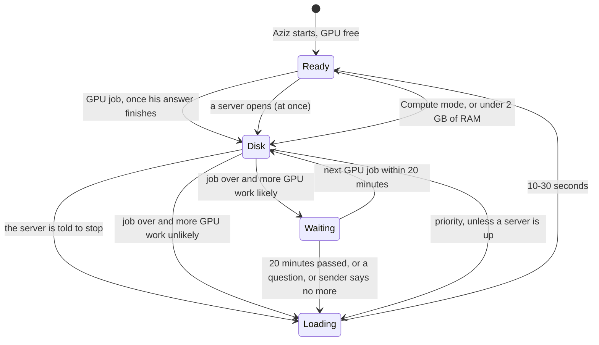

# Aziz

Aziz manages one GPU machine. He decides who gets the GPU, runs heavy work in order, keeps Kamil (the local model) ready as
much as he can, and writes down every decision. He was written for [Kamil](https://github.com/KaramelliSundae/kamil-ai-helper),
a study assistant.

## How it works



## Two modes

| Mode | What it means | Kamil |
|---|---|---|
| **AI-Asistan** (`assistant`, the default) | Nothing else holds the GPU | Ready. He moves aside for a job and comes back by himself |
| **Compute** (`compute`) | The machine belongs to compute work: jobs and servers | On disk until the work is over and the mode allows him back |

Compute work comes in two kinds:

| | Ends | Time limit | What stops it |
|---|---|---|---|
| **Job** | By itself | 4 hours on the GPU, 12 on the CPU, up to a day | Its end, a cancel, or something with a better claim. It then starts again |
| **Server** | Only when told to | None | Only a stop, from the app, the sender or by hand. Not priority, not low memory, not another server |

One switch does it all: `POST /mode`, the app's Settings, or `ai-ders mode`. A machine can name one server of its own in `/etc/aziz/env`,
called the image app in this repository, and it stays on disk until wanted:

- **Choosing Compute** puts Kamil on disk and opens the image app.
- **Choosing AI-Asistan** closes the image app and any GPU server, and Kamil comes back. With one of them up it needs a second word,
  `{"mode": "assistant", "confirm": true}`, which the app asks for. CPU servers stay.

While a server holds the GPU, `/state` reads `compute`. A reboot in Compute opens the image app again; otherwise a reboot leaves it on
disk, so keep its unit disabled. A real unit is the truth about it, so one started by hand counts all the same. The mode survives a
restart. The old names, `auto` and `image`, still work.

CPU work leaves Kamil alone. A GPU job may run beside an idle image app, steps aside when that app starts working, and goes back in the queue.

## Who talks to him

```mermaid
flowchart LR
    image_app[Image app] -- "POST /preempt: I have work" --> aziz
    api[Kamil API] -- "POST /acquire: a question came" --> aziz
    phone[AI Ders app] -- "status, priority" --> api
    skill[Offload skill on the Mac] -- "POST /jobs + how likely more GPU work is" --> aziz
    aziz{{Aziz\nport 8421, localhost only}}
    aziz -- "start / stop" --> model[Kamil's model\nai-ders-llm]
    aziz -- "start / stop" --> cpu[offload-job@id]
    aziz -- "start / stop" --> gpu[offload-gpu-job@id]
    aziz -- "start / stop" --> server[offload-gpu-server@id, offload-server@id]
    aziz -- "start / stop, when asked" --> image_app
    aziz -- "writes" --> log[(Logbook\n1 MB at most)]
```

## Where Kamil is



## How a GPU job is decided


## API

| Route | What it does |
| --- | --- |
| `POST /jobs` | `{id, label, gpu, nextGpu: "likely"\|"unlikely", restart, maxMinutes, server}`. Aziz starts its unit when its turn comes: `offload-gpu-job@ID` or `offload-job@ID`, and `offload-gpu-server@ID` or `offload-server@ID` with `server: true` |
| `GET /jobs/ID`, `POST /jobs/ID/cancel` | One job's or server's status; cancel or stop it |
| `POST /forecast` | `{nextGpu}`: update the guess. It can end the wait, never extend it |
| `POST /priority` | `{on}`: Kamil first for 30 minutes. Refused in Compute mode and while a GPU server is up |
| `GET /state`, `GET /log?limit=100` | Everything now; the logbook |
| `POST /mode` | `{mode, confirm}`: the switch. A 409 with `needsConfirm` means a server is up and it takes `confirm: true` |
| `POST /preempt`, `/acquire` | Used by the image app and the Kamil API |

Job names are `[a-z0-9-]`, at most 63 characters. A job interrupted by the image app or priority starts again from the
beginning, at most 3 times; send `restart: false` if rerunning it is not safe. GPU jobs stop after 4 hours and CPU jobs
after 12 unless `maxMinutes` says otherwise, up to a day. Servers have no limit and come back after a reboot. A GPU unit needs
`TimeoutStopSec` under 10 s, so the image app never waits.

## Sending work from the Mac

The Mac side is a global skill and MCP tools in `~/.claude/skills/offload`, off until a project says `/offload on`.
**To connect it, run `deploy/offload/connect.sh` once, yourself.** It adds a dedicated key and SSH rule, with an automatic
undo until a fresh login works. Until then nothing can log in as `offload`.

- `client/`: the skill, `offload.py` and the MCP server. `client/install.sh` installs them.
- `deploy/offload/offload_gate.py`: all the key can run. Names and paths are checked there, and jobs go through Aziz.
- `deploy/offload/job.service.in`: the job sandbox, for CPU and GPU. No secrets, no local network, no local sockets, internet yes.

A job's project stays at `/var/lib/offload/jobs/<project>` with its caches; old job logs go after 14 days.

## Limits worth knowing

- **What survives a restart:** jobs, the GPU mode and the logbook. The 20-minute wait and priority do not, on purpose:
  a crash or reboot must bring Kamil back, never strand him.
- **No login:** he listens on localhost without a password, so job sandboxes must block localhost. Unit names are checked.
- **Two programs on one GPU:** a GPU server and the image app are not told apart by memory. If both are up, they share what the GPU has, and it is up to you to close one.
- **Not tried yet:** a real image job during a real GPU job. `/preempt` itself was tested on the real machine, freeing
  6 GB in 0.6 s, and the image app allows 20 s.

## Everyday

```sh
systemctl status aziz
journalctl -u aziz -n 30            # his log, also in /var/lib/aziz/journal.jsonl
curl -s localhost:8421/state        # on the server
deploy/deploy.sh                    # update, from this repo; waits until the image app is idle
```

## Tests

```sh
uv run --group dev pytest                                   # light, fine anywhere
AZIZ_SIM_SEEDS=4000 deploy/capped.sh pytest tests/test_simulation.py   # on the server, half a core and 1 GB at most
```

`tests/test_simulation.py` lives random days in the machine's life with faults, crashes, reboots and the image app interruptions,
and checks what must always hold: one GPU job at most, never beside the model or the image app, and in the end every job
finished and the model back. See [docs/scenarios.md](docs/scenarios.md) for each case.

## Setting him up on your machine

`deploy/deploy.sh user@server` installs him. What only your machine knows goes in files outside the repository:

| File | What goes in it |
| --- | --- |
| `/etc/aziz/env` | `AZIZ_IMAGE_APP_UNIT`, the systemd unit of your image app; `AZIZ_IMAGE_APP_HEALTH`, its health address; `AZIZ_IMAGE_APP_NAME`, what to call it on the phone |
| `/etc/aziz/offload.env` | `OFFLOAD_EXTRA_HIDDEN`, more paths to hide from jobs; `OFFLOAD_TOOL_BINDS`, tools to lend them |

The image app reports `gpuGate: true` and its queue on its health address, and calls `POST /preempt` before it takes the GPU. To let
Aziz open and close it, disable its unit and add a polkit rule on that machine that lets the `aziz` user start and stop it.
